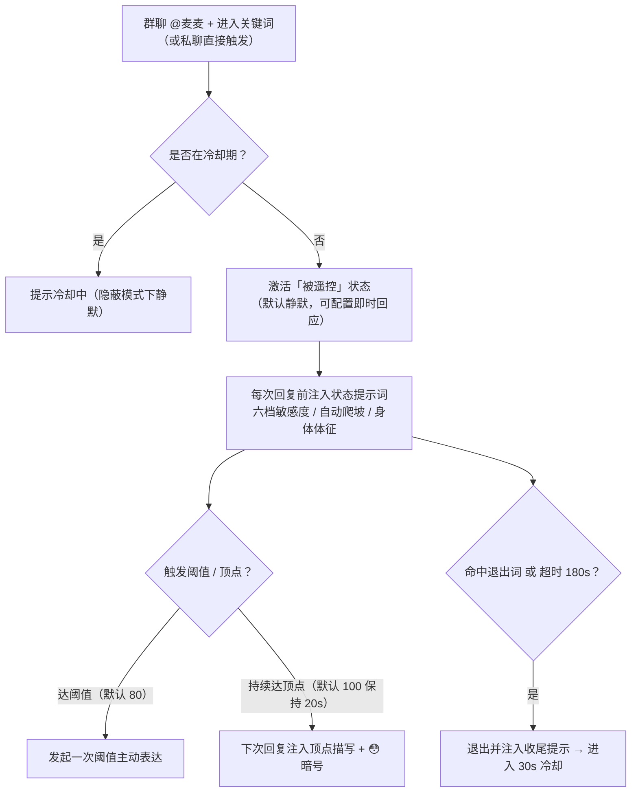

<div align="center">

  <!-- Hero Banner (亮/暗色主题自适应) -->
  <picture>
    <source media="(prefers-color-scheme: dark)" srcset="https://cdn.jsdmirror.com/gh/NetaJuutilainen/maibot_immersive_control_plugin@main/assets/readme/hero-night.svg">
    
  </picture>

  <br/>

  <!-- Badges -->
  <p>
    
    = 1.3.0">
    <a href="LICENSE"></a>
    
    <a href="#交流与反馈"></a>
  </p>

  <p>
    给麦麦装上一个"特殊装置"，然后遥控它 —— <b>六档敏感度</b> · <b>自动变化节奏</b> · <b>阈值主动表达</b> · <b>顶点与隐蔽反馈</b><br/>
    全部参数可在 <b>WebUI「麦麦遥控器」</b>实时配置，可选与 <b>麦麦身体</b> 联动<br/>
    <sub>移植重构自 <a href="https://github.com/muyouzhi6/astrbot_plugin_immersive_control">astrbot_plugin_immersive_control</a>（木有知 / Zhalslar，MIT）· 当前版本 <b>1.2.0</b></sub>
  </p>

  <!-- Quick Navigation -->
  <p>
    <a href="#这是什么">这是什么</a> &middot;
    <a href="#玩法与流程">玩法与流程</a> &middot;
    <a href="#敏感度系统">敏感度系统</a> &middot;
    <a href="#麦麦身体联动">麦麦身体联动</a> &middot;
    <a href="#管理命令">管理命令</a> &middot;
    <a href="#安装与兼容">安装与兼容</a> &middot;
    <a href="#交流与反馈">交流与反馈</a>
  </p>

</div>

> [!NOTE]
> 🐛🪲🐞 **遇到问题请提 issue，别等着**：[github.com/NetaJuutilainen/maibot_immersive_control_plugin/issues](https://github.com/NetaJuutilainen/maibot_immersive_control_plugin/issues)  
> 「关键词没反应 / 触发不了 / 行为不对」都欢迎直接提。提 issue 会强制走表单
> （插件版本 / 宿主版本 / 适配器 / 复现步骤 / 消息原文形态 / 日志），照着填即可。

---

<a id="这是什么"></a>
## 🎭 这是什么？

麦麦正一本正经地在群里聊天，突然你按下遥控器——

祂开始慌乱、害羞、结巴、语无伦次……

**这个插件就干这事。** 关键词触发后麦麦进入"被遥控"状态，在后续回复中自然融入沉浸式反应，持续一段时间后自动结束。支持六档敏感度、自动变化节奏、阈值主动表达、顶点效果与隐蔽反馈，全部参数可在 WebUI 配置。

移植自 AstrBot 插件 [astrbot_plugin_immersive_control](https://github.com/muyouzhi6/astrbot_plugin_immersive_control)（原作者：木有知 / Zhalslar，MIT），针对 MaiBot 1.2.x + maibot-plugin-sdk 2.x 重写，沿用原版"沉浸式互动"的提示词风格，默认模板保持全年龄可读。

---

<a id="玩法与流程"></a>
## 🎮 玩法与流程

1. 群聊里 **@麦麦 + 进入关键词**（默认 `控制` / `遥控` / `我要控制你了` / `td`，去掉首尾空白后完全一致才触发；`@` 与关键词之间有没有空格都认（v1.2.1 起）；私聊无需 `@`）→ 该会话进入"被遥控"状态，默认静默激活，可在配置中改为触发瞬间立刻回应；
2. 之后麦麦的**每一条回复**前都会注入状态提示词：祂表面上还在正常聊天，但会漏出破绽——慌乱、结巴、分神，强度由敏感度档位决定；
3. 命中**退出关键词**（默认 `停止` / `停止控制` / `结束` / `结束控制`）→ 静默结束，下一条回复注入一次收尾提示词；或到达 `state_duration`（默认 180 秒）自动结束；
4. 结束后进入冷却（默认 30 秒），冷却期触发会收到提示（隐蔽模式下不可察觉）。

> 道具名称默认叫"特殊装置"，你可以在配置里自定义为任何你想要的名称。



---

<a id="敏感度系统"></a>
## 🎚️ 敏感度系统

### 六档效果

模板可在 WebUI 修改，注入时按当前值自动附加对应档位说明：

| 档位 | 效果 |
|---|---|
| `0-20` | 几乎无感：极细微的破绽，偶尔一个停顿或走神 |
| `20-40` | 隐约：偶尔忽然有点慌神，语气微微不稳 |
| `40-60` | 轻微：时不时紧张一下、偶尔结巴、容易分神 |
| `60-80` | 中等偏强：慌乱一阵阵上来、明显难以维持正常对话 |
| `80-100` | 强烈：接近招架不住，慌乱和结巴怎么压都压不住 |
| `100-120` | 完全招架不住（**仅限指令设置**）：害羞慌乱彻底占了上风 |

### 控制机制

- **指令调档**：`/强度 <0-120>`（会话级覆盖，持久化），`/强度 max` = 120，`/强度 全局` 恢复跟随全局，不带参数查询当前值与计时状态；范围外直接拒绝；
- **自动模式**：`/强度 自动` → 从 30 爬升到 100（约 3.5 分钟），随后在 50↔100 之间往复（每程约 2.5 分钟），速度由 `auto_speed_per_minute`（默认 20 点/分钟）控制；
- **阈值主动表达**（`proactive_threshold`，默认 80，0 = 关闭）：敏感度达到阈值时，麦麦自主发起一次主动表达（每次激活限一次）；
- **顶点效果**（`climax_threshold` 默认 100 + `climax_hold_seconds` 默认 20 秒）：敏感度保持在阈值以上达到时长后，下一次回复注入一次"彻底招架不住、大脑一片空白"的描写（`climax_template` 可改），并以 `climax_emoji`（默认 😳，留空关闭）收尾作为暗号；每次激活最多触发 `climax_max_per_activation` 次（默认 3），中途跌破阈值重新计时。

---

<a id="麦麦身体联动"></a>
## 🫀 与「麦麦身体」联动（v1.1.0 新增，默认关；v1.2.0 支持 body 1.3.0+ 情绪）

装了 [maibot-body-emulator](https://github.com/ShuangziG/maibot-body-emulator) 时，可在配置 `[linkage]` 中开启联动（**全部默认关**，关闭时行为与 v1.0.3 完全一致）：

- **身体状态进文案**：激活期间按体征追加描写（精力低 / 饿 / 不舒服 / 睡着 + 压力三档分级，随强度爬坡换词）；
- **压力写回**：压力向「预计压力 = `15 + 75 × 强度/120`」追踪——强度升压力涨、强度降自然回落；道具停下或顶点额度用尽时泄压一次，自然超时不泄压；无会话时主动冷却让回落肉眼可见；
- **睡眠场景**：睡着时滴灌照常并积累觉醒值，引爆阈值随睡眠深度（深睡难醒 / 浅睡易醒），自然醒来瞬间达标则触发余韵引爆与模糊记账；
- **WebUI「麦麦遥控器」**：状态页（觉醒条 / 压力对比 / 激活会话）+ 40+ 项快捷配置 + 快捷动作（立即泄压 / 清空会话 / 暂停 / 恢复），主题跟随宿主（原版 / 复古 / 千禧 × 明暗）；
- **情绪联动（v1.2.0，需 body ≥ 1.3.0）**：
  - 只读：欣快 ≥ 60 追加亢奋描写（`body_excited_text`），烦躁 ≥ 60 追加烦躁描写（`body_irritable_text`），与原有压力三档可叠加；
  - 写回：**顶点脉冲 + 余韵 + 锯齿压力**——每次顶点小泄压 `−4` 并给 `12 × 0.75^(n−1)` 的瞬时心情（第 2/3 次递减），让愉悦有峰值而非一条直线；到过顶点后正常停下再给 `−15` 压力 + `+5` 余韵心情；没到顶点直接停只泄压、不发心情，自然超时与睡眠中不写心情；
  - body 1.2.x 及更早：缺情绪字段自动回退 0，其余联动照旧，不影响使用。

> [!TIP]
> 健壮性：联动失败自动降级（3 秒超时、连续失败熔断 300 秒、字段级守卫），绝不影响遥控本体；联动全程不产生任何额外 LLM 调用。

---

<a id="管理命令"></a>
## ⚙️ 管理命令（管理员）

| 命令 | 说明 |
|---|---|
| `/强度 <0-120>` / `max` / `自动` / `全局` | 设置 / 查询本会话强度（见上） |
| `/imm_status`（别名 `控制状态`） | 本会话状态与激活会话数 |
| `/imm_clear` | 清除所有会话的遥控状态 |
| `/imm_config`（别名 `控制配置`、`/imm_reload`） | 查看当前生效配置 |

管理员在 `control.admin_ids` 中声明，支持 `"123456"` 与 `"qq:123456"` 两种写法。所有配置在 WebUI 修改即热更新。

---

<a id="安装与兼容"></a>
## 🚀 安装、兼容与隐私

### 安装步骤

1. 将本目录放入 MaiBot 的 `plugins/` 目录（或从插件中心安装）；
2. WebUI（`http://127.0.0.1:8001`）插件管理中启用；
3. 首次安装因 manifest 能力声明需**完整重启一次 MaiBot**，之后改代码 / 配置走热加载即可；
4. 建议先把管理员 QQ 号填入 `control.admin_ids`。

> [!WARNING]
> **兼容性要求**：适配 MaiBot **1.3.0 及以上**（manifest `host_application.min_version`）。更早的宿主不在本移植的目标范围内——彼时缺少 `maisaka.*` 注入钩子，开启控制后可能表现为“激活了但没有任何反应”。  
> 如果激活后确实无反应，请先确认：① 群聊里是否 `@` 了麦麦（`require_at` 默认开启）；② 关键词是否为完整句（如直接发 `控制`，而不是“控制一下”）；③ 默认静默激活，状态体现在**下一条回复**里，触发瞬间不会立刻有提示；④ v1.0.2 起关键词识别已不依赖适配器预填 `processed_plain_text`（旧版本在部分适配器上会完全不识别，请先升级到 v1.0.2）；⑤ v1.2.1 起群聊 `@` 与关键词之间没有空格、适配器只给 CQ 字符串或 `mention` 段也能识别（旧版本会静默放行，请先升级）。

<details>
<summary><b>🧪 展开查看：离线验证与数据隐私说明</b></summary>

#### 离线验证（无需启动 MaiBot）

```bash
python tests/verify.py
```

覆盖组件声明、manifest / 配置校验、命令正则、状态机全路径（冷却 / 并发 / 到期 / 退出 / 持久化）、钩子端到端（含无 `processed_plain_text` 适配器的兜底识别）、自动曲线 / 阈值 / 顶点效果触发等 208 项检查。

#### 数据与隐私
- 会话状态（会话 ID、触发者 `user_id`、敏感度设置与各类计时信息）只保存在插件本地 data 目录的 `state.json`，仅用于 MaiBot 重启后恢复状态，**不会上传到任何服务器**；卸载插件或删除该文件即全部清除；
- 插件自身没有任何网络请求；发送到群里的内容仅限配置中的状态回执与提示文本，提示词注入只进入麦麦自己的回复生成流程。

</details>

---

<a id="交流与反馈"></a>
## 💬 交流与反馈

<div align="center">

<table>
  <tr>
    <td align="center" width="50%">
      <br/>
      <b>🐧 QQ 交流与插件测试群</b><br/><br/>
      <br/><br/>
      群号：<code>556461602</code><br/>
      <sub>插件使用交流 · 配置调优 · 新版合成测试体验</sub>
      <br/><br/>
    </td>
    <td align="center" width="50%">
      <br/>
      <b>🐛 问题反馈与功能建议</b><br/><br/>
      <a href="https://github.com/NetaJuutilainen/maibot_immersive_control_plugin/issues">前往 GitHub Issues 提交</a><br/><br/>
      <sub>提 Bug 建议附上宿主版本、适配器与触发消息全文</sub>
      <br/><br/>
    </td>
  </tr>
</table>

</div>

---

## 📄 致谢、许可与免责声明

- 原版：[muyouzhi6/astrbot_plugin_immersive_control](https://github.com/muyouzhi6/astrbot_plugin_immersive_control)（MIT）
- 本移植：MIT，见 [LICENSE](LICENSE)

> [!WARNING]
> **免责声明**：本插件纯属娱乐，为沉浸式互动 / 角色扮演辅助，请在群成员自愿、氛围合适的前提下使用，勿用于骚扰他人，合理使用，后果自负。
